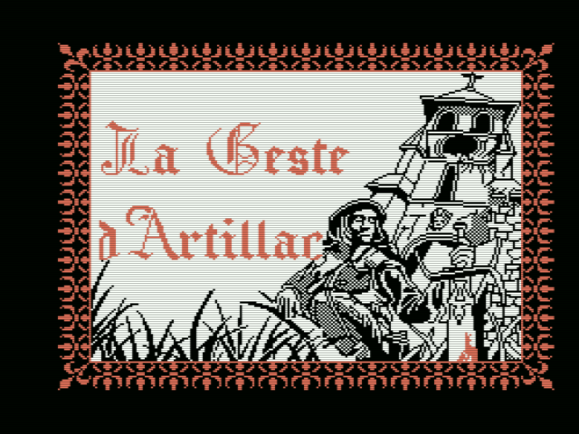
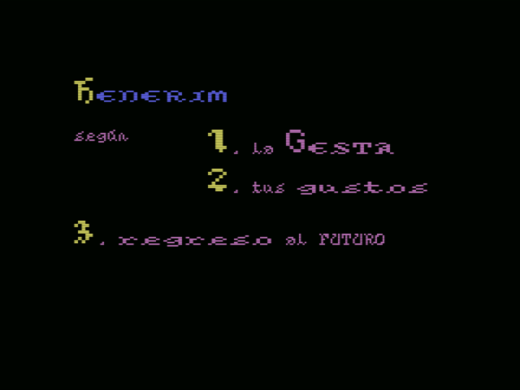
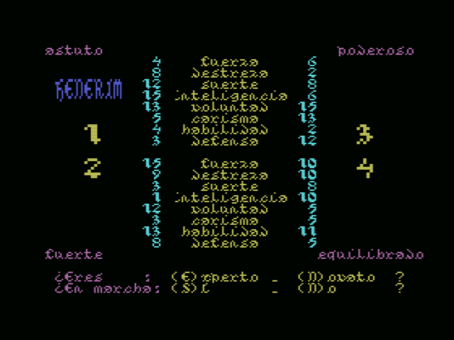
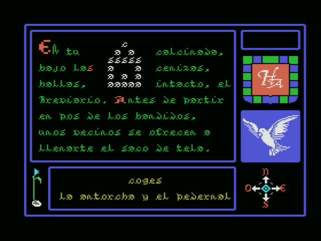
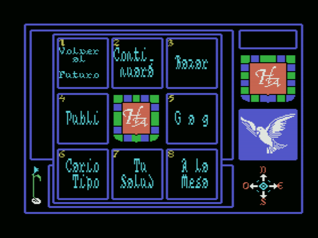
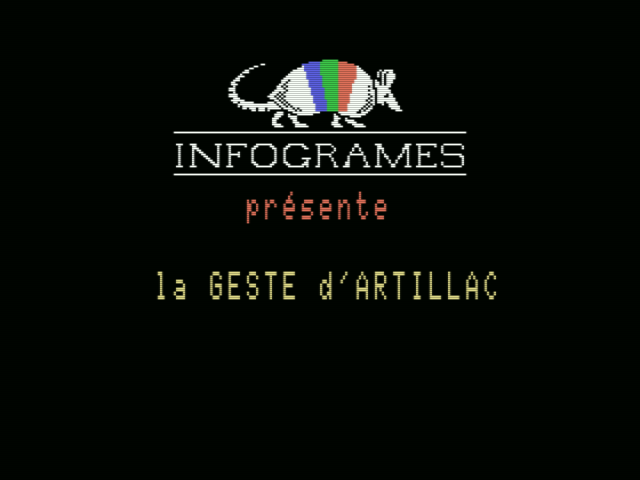

# La Geste d'Artillac en castellano (MSX)

Traducción completa al castellano de *La Geste d'Artillac* (Infogrames, 1985), aventura de texto e ilustraciones para MSX que solo salió en francés y en cinta. Va en un cartucho MegaROM, sin cinta: se juegan los diez cantos de la Gesta sin cambiar de cara ni esperar cargas.

  
  

## Descarga

[`releases/GesteArtillac_ES_v1.0.rom`](releases/GesteArtillac_ES_v1.0.rom): 256 KB, mapper ASCII16 (openMSX y blueMSX lo detectan solos). SHA-1 `9a2813f3c1d59b73d52f64b9c923a843c5338149`.

Funciona en cualquier MSX con 64 KB de RAM. En el One Chip MSX, su cargador puede equivocarse de mapper: cárgala con `mglocm /f` (ASCII16 forzado). No se ha probado en ese aparato.

## Qué lleva

- **Todo en castellano:** la creación del personaje, los mensajes del motor, el menú H, los objetos y los diez cantos (del 1 al 5 y del 7 al 11; los cantos 6 y 12 de la cinta están vacíos). Se ha mantenido el tono del original, y los caligramas (las palabras dibujadas con letras dentro del texto) se han rehecho en castellano.
- **Letras nuevas:** ñ, ¿ y ¡ en las dos fuentes del juego.
- **Detalles adaptados:** «(O)ui / (N)on» pasa a «(S)í / (N)o», el menú dice «Volver al Futuro», y la brújula pone N, S, E y O con la N y la S centradas sobre la flecha.
- **Sin cinta:** las pantallas de Infogrames y del título esperan a que pulses una tecla (en cinta duraban lo que la carga siguiente).
- **Música a su tempo:** la música de la creación del personaje suena a 50 Hz también en las máquinas de 60 Hz.

El juego es el mismo: no se han cambiado las pruebas, los objetos ni los caminos.

## Cómo se juega

- **Activa BLOQ MAYÚS (CAPS).** El juego solo entiende las órdenes en mayúsculas.
- Cursores para elegir la opción y RETURN para confirmarla.
- **H** abre el menú de la Gesta: Volver al Futuro, Continuará, Bazar (coger y dejar objetos), Publi, Gag, Cariotipo, Tu Salud y A la Mesa (comer). **I** enseña el dibujo y **B** la brújula.
- Para comer: H, 8 y RETURN por cada ración. Si no comes, el hambre te va quitando vida.
- **Novato** empieza con 30 puntos de vida y **Experto** con 10. Es la única diferencia.
- Ninguno de los cuatro personajes ya hechos de «1. la Gesta» puede terminar el juego. Créalo con «2. tus gustos». Un reparto que llega al final: Fuerza 3, Destreza 10, Suerte 10, Inteligencia 12, Voluntad 11, Carisma 3, Habilidad 13 y Defensa 2 (flecha derecha o izquierda para subir o bajar, arriba o abajo para cambiar de línea, RETURN para aceptar).

## Guía y documentación

- [`docs/GesteArtillac_solucion.pdf`](docs/GesteArtillac_solucion.pdf): solución completa, paso a paso. Se ha jugado entera en openMSX con el teclado, sin tocar la memoria. Dice cuándo comer y qué hacer si una tirada al azar sale mal.
- [`docs/CURIOSIDADES.md`](docs/CURIOSIDADES.md): créditos escondidos, los dos finales, el código secreto y otras cosas que han salido del desensamblado.
- [`docs/TECNICO.md`](docs/TECNICO.md): la cinta, la memoria, el formato de los cantos, la ROM y cómo está hecha la traducción.

## Construir la ROM

No se incluye nada del juego original. El desensamblado (`src/`) lleva el código comentado, pero los datos (gráficos, textos en francés, fuentes y tablas) van como huecos `defs n,RELLENO`. Se rellenan con los bytes de tus propias cintas:

1. Copia las tres cintas `.cas` de la versión francesa en `originales/` (ver [`originales/LEEME.md`](originales/LEEME.md)).
2. Ejecuta `python3 build.py`.

`build.py` saca los datos de las cintas y comprueba su SHA-1 (`tools/extrae_originales.py`). Después ensambla el original dos veces (RELLENO = 00h y FFh), rellena los huecos y comprueba que sale idéntico. Con eso monta la traducción y escribe `salida/GesteArtillac_ES.rom`. Al final la compara con la de `releases/`.

Hacen falta Python 3 y sjasmplus o pasmo en el PATH. Comprobado con pasmo 0.5.3 desde una copia limpia del repositorio (`git archive`): sale la misma ROM que la de `releases/`.

Carpetas:

- `src/`: desensamblado propio de la cinta 1, hecho desde cero: `etapa2.asm` (cargador), `creacion.asm` (creación del personaje) y `motor.asm` (motor del juego).
- `rom/`: arranque y lector de la versión en cartucho.
- `traduccion/`: los textos en castellano.
- `tools/`: extracción de las cintas, ensamblado con huecos y montaje de los textos.

## Licencia y avisos

- Herramientas y scripts de montaje (`build.py`, `tools/`): [MIT](LICENSE).
- Desensamblado comentado, fuentes de la ROM, traducción y documentación: [CC BY-NC-SA 4.0](LICENSE-CC).
- *La Geste d'Artillac* es © Infogrames (1985). El código, los gráficos, los textos y la música originales son de sus titulares, y ninguna de las dos licencias los cubre. Tampoco cubren la ROM de `releases/`.
- Es un homenaje sin ánimo de lucro: no se distribuyen cintas ni volcados originales. Si algún titular de derechos lo pide, se retira.

## Créditos

- **La Geste d'Artillac:** Infogrames, 1985. En el juego, los autores firman con apodos de juglar: André le Conteur, François le Rêveur, Philippe le Jongleur y Thierry le Baladin, «y la compañía del Tatú».
- **Volcados de las cintas:** Martos.
- **Traducción al castellano y versión en cartucho:** araubi (dirección y pruebas). Desensamblado, traducción, ROM y documentación desarrollados con Claude (Anthropic).
